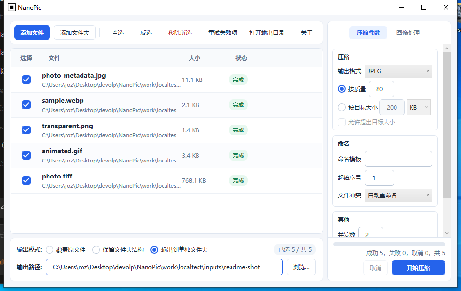

# NanoPic

**一个小于 2 MB 的单文件工具，帮你批量压缩和转换图片。**

免安装 · 双击即用 · 图片不出电脑

[下载正式版](https://github.com/luvcamor/NanoPic/releases/latest) · [问题反馈](https://github.com/luvcamor/NanoPic/issues)

NanoPic 是一款 Windows 上的图片压缩和转换小工具。把图片拖进去，设好想要的格式和大小，点一下开始，它就能帮你把一堆图片一次性处理好。

## 它好在哪

- **体积小**：整个软件只有一个文件，小于 2 MB，不占地方
- **免安装**：下载解压就能用，不用装这装那，删掉也不留痕迹
- **省事**：一次能处理一大堆图片，多张同时进行，速度快
- **保持清晰或文件更小**：默认保留原格式并优先保护细节；PNG 不默认减色。照片和文字可分别选择策略，目标过小时明确提示，不擅自降低到极低质量
- **防止无效重编码**：同格式且像素、元数据均未改变时，重编码不更小就保留原始文件数据，并显示“无需再压缩”；格式转换或主动修改图片不保证文件更小
- **超大图片也能处理**：遇到超高像素的图片自动缩小，不会报错
- **放心**：图片全程在你电脑上处理，不用上传到任何网站

## 界面预览

## 能做什么

- 支持 `JPG`、`PNG`、`WEBP`、`GIF`、`BMP`、`TIFF`、`ICO` 这些常见格式
- 批量压缩、转换格式、调整尺寸
- 手机竖拍的照片自动摆正
- 加文字水印、调亮度
- 自己定义输出的文件名和存放位置
- 可选把「添加到 NanoPic」放进图片的右键菜单
- 支持快捷键操作（如 `F5` 开始、`Esc` 取消）
- 列表上方可直接「移除勾选」；只想移除个别图片，可选中行后按 `Delete`，或右键「从列表移除」。这些操作不会删除原文件

## 怎么用

1. 去 [Releases](https://github.com/luvcamor/NanoPic/releases/latest) 下载 `NanoPic.exe`；如果下载的是便携压缩包，请先解压
2. 双击运行 `NanoPic.exe`
3. 把图片拖进窗口，或点「添加图片 / 添加文件夹」
4. 选好格式、大小等设置
5. 点「开始压缩」（或按 `F5`）

## 怎样选择压缩方式

- **保持清晰（默认）**：自动判断照片或文字，优先保护细节。PNG 不默认减色，文字 WebP 使用无损编码，文字 JPEG 保留完整色度。图片可能无法明显变小。
- **文件更小**：允许更多画质损失；可在「更多选项」中调整手动质量。质量数值不是文件大小或清晰度百分比，100 也不统一代表无损。
- **指定大小**：填写需要的 KB / MB。无法兼顾清晰度时会提示，不为了达标无限降低质量。允许稍大、允许缩小长宽，都需要在「更多选项」中单独开启。
- **图片类型**：默认自动判断，不需要逐张设置。自动判断是本地抽样规则，不是 OCR 或保证正确的识别器；手稿、截图等可在「更多选项」中手动指定。旧设置中已有的照片/文字选择会保留。
- **前后对比**：处理完后双击图片，查看原图和结果的同倍率全图，或点击全图任意位置查看原尺寸细节（默认查看中心区域）。若替换了原图、结果不存在或两条路径指向同一文件，不会假装保留了处理前的副本。
- **编辑图片**：调整长宽、水印等选项默认收起，开启后显示「已设置」。超大图片的安全缩小仍是独立设置，会改变长宽。

### 保存与批处理安全

- 每张图片处理完成就更新列表状态；总进度和本批结果统一显示在列表底部。处理中继续添加的图片会提示「下次处理」，不会混入当前批次。
- 另存文件夹和保留文件夹结构会记住上次选择；「替换原图」只在本次使用生效，下次启动默认另存，避免误覆盖。
- 批处理会先检查所有输出位置；任何输出若会覆盖另一张待处理原图，就停止该项并提示。重名输出可选择自动重命名。
- 关闭窗口会先取消并等本批任务收尾；关闭亮度、水印等功能后，其输入草稿可保留，但不会再影响图片。
- 重新处理图片时旧预览会关闭，处理完成后打开的是本次结果。跳过已有文件时不把该文件当成本次生成的压缩结果。
- 图片备注仅支持 JPEG、PNG、TIFF；保持原格式批处理遇到不支持的格式会明确标记「备注未写入」，并继续保留原图防膨胀保护。

### 清晰度保护的边界

「保持清晰」除了质量参数下限，还会对有损 JPEG/WebP 结果做轻量抽检：缩略全图和最多九个原尺寸局部，结合局部结构相似性、颜色偏差及细线边缘误差。每个文件最多复查三次；未通过时尝试更高质量，或在允许且不改变内容的情况下保留原文件，否则不保存有明显细节损失风险的候选。

这是抽样保护，不是整图视觉无损证明，也不能保证每个角落都被检查。PNG 不减色和文字 WebP 无损编码不需要重复做这类有损评分。输出仍须经过独立的格式、尺寸与原子写入验证。预览直接读取解码像素，不再先把源图做有损调色板编码；WebP 使用无损 PNG 解码桥接。预览有独立的内存预算，过大的图片可能暂不支持预览。

同格式且像素、元数据均未变化时，重编码没有变小就保留原始文件数据，列表显示「无需再压缩」。悬停状态可查看尺寸、体积、识别类型和处理说明。

## 右键菜单集成（可选）

默认关闭。在「压缩 → 偏好设置」里勾选**在右键菜单中添加入口**后，选中图片点右键就能看到「添加到 NanoPic」，一次选多张也会整批进入同一个窗口的队列。

- 只对上面列出的图片格式生效（`.jpg` `.jpeg` `.jpe` `.jfif` `.png` `.webp` `.gif` `.bmp` `.tif` `.tiff` `.ico`）；选中的文件里混有其他类型时不显示这个菜单
- **Windows 11**：先点右键菜单里的「显示更多选项」，菜单在经典列表中；Windows 10 直接显示
- 只写入当前用户的设置，不需要管理员权限，也不会改变图片的默认打开方式
- NanoPic 已经打开时，图片加入最近使用的那个窗口；正在压缩时新加入的图片排在队列里等下一批
- 挪动了 `NanoPic.exe` 的位置：下次启动会自动把菜单指向新位置；如果旧位置的程序还在，会让你选择「设为当前版本」
- 取消勾选即彻底移除；只删除 NanoPic 自己写入的项，不会动其他软件的右键菜单
- 如果开关旁提示「需要修复」或「存在冲突」：前者点「修复」即可，后者说明同名项被其他程序改写，可点「复制诊断信息」后到 Issues 反馈

## 问题反馈

遇到问题欢迎到 [GitHub Issues](https://github.com/luvcamor/NanoPic/issues) 提出来，或通过程序「关于」页面里的「联系作者」入口反馈。

## ⭐️ 喜欢这个项目吗？
如果这个项目对你有帮助，欢迎给一个 **Star** 给予支持！你的支持是持续更新的动力 🚀

## 许可

本项目开源，详见 [LICENSE](LICENSE)。
