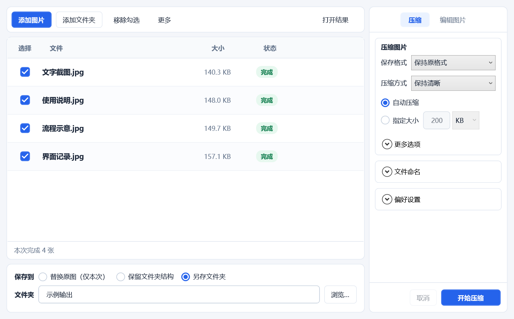
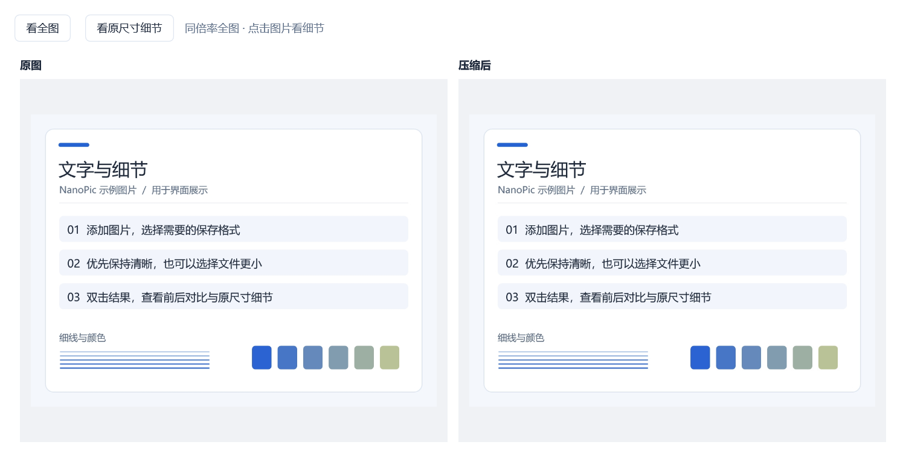

# NanoPic

**小于 2 MB 的 Windows 单文件图片工具，批量压缩、转换，还能查看前后对比。**

免安装 · 本地处理 · 图片不上传

[下载单文件 EXE](https://github.com/luvcamor/NanoPic/releases/latest/download/NanoPic.exe) · [查看更新与完整压缩包](https://github.com/luvcamor/NanoPic/releases/latest) · [问题反馈](https://github.com/luvcamor/NanoPic/issues)

把图片拖进来，选择想要的格式、压缩方式和保存位置，就能一次处理多张图片。优先保护文字与细节，也可以按需要选择更小的文件；每张图片完成后立即显示结果，不必等整批结束。

> 运行环境：64 位 Windows，需要 .NET Framework 4.8。下载 ZIP 后请先解压；升级前请关闭旧版 NanoPic。

## 界面预览

**主界面示意**：常用设置直接可见，更多选项按需展开；处理结果集中在图片列表，移除图片不用再进入二级菜单。

查看前后对比界面

处理完成后双击图片，在同倍率下查看原图和结果。点击图片，或选择「看原尺寸细节」，检查文字、边缘等局部。

*截图使用生成的示例图片和示例输出目录，不包含真实用户文件路径；仅展示操作界面，不代表所有图片都能获得相同压缩效果。*

## 能帮你做什么

- **批量压缩与转换**：支持 JPG、PNG、WebP、GIF、BMP、TIFF、ICO。
- **按需要选择压缩方式**：优先「保持清晰」，或选择「文件更小」；有上传大小限制时，可填写目标 KB / MB。
- **更照顾文字图片**：自动判断照片与文字类内容，手稿、截图也可手动选择图片类型。
- **看得见处理进度**：逐张更新状态，列表底部显示本批进度和结果；处理中新增的图片留到下一批。
- **处理后直接比较**：查看同倍率全图和原尺寸局部，自己判断细节是否满意。
- **顺手编辑图片**：调整长宽、自动摆正方向、调亮度、加文字水印，以及删除拍摄信息。
- **保存更灵活**：自定义命名，集中另存或保留子文件夹结构；可选集成到 Windows 图片右键菜单。

## 三步开始

1. **添加图片**：拖入图片，或点击「添加图片」「添加文件夹」；勾选需要处理的图片。
2. **选择设置与保存位置**：不确定怎么选时，使用默认的「保持原格式」和「保持清晰」，再选择一个输出文件夹。
3. **点击「开始压缩」**：每张图片完成后立即更新状态。点击「打开结果」查看输出文件，双击图片查看预览或前后对比。

### 怎么选压缩方式？

| 你的需要 | 建议选择 | 需要知道 |
| --- | --- | --- |
| 更在意文字、边缘和细节 | **保持清晰**（默认） | 优先保护细节，文件不一定能明显变小 |
| 更在意文件体积 | **文件更小** | 允许更多画质损失；可在「更多选项」中调整手动质量 |
| 需要满足上传大小限制 | **指定大小** | 填写 KB / MB；目标过小时会提示，是否允许稍大或缩小长宽需要单独开启 |

「指定大小」可以配合所选压缩方式使用。手稿或截图可在「更多选项」中手动指定图片类型；「编辑图片」里的尺寸、亮度、水印等功能按需开启，非默认设置会显示「已设置」。

PNG 指定大小采用有限候选搜索，并检查失败候选上方的小范围非单调区间；满足大小限制不代表已穷举得到全局最优画质。

> **压缩不等于缩放，也不等于一定无损。**质量数值不是清晰度或文件大小的百分比，100 也不统一代表无损。手动调整尺寸、允许为目标大小缩小长宽，以及超大图片安全缩小，都可能改变长宽。

### 图片会保存到哪里？

| 保存方式 | 实际效果 |
| --- | --- |
| **另存文件夹** | 把结果集中放进你填写的输出文件夹 |
| **保留文件夹结构** | 仍保存到输出文件夹，在其中保留本批图片公共目录下的子文件夹层级 |
| **替换原图（仅本次）** | 同格式写回原文件；转换为其他格式时，在原目录生成新文件。请先备份原图 |

例如，所选图片来自 `照片/旅行/` 和 `照片/工作/`，选择「保留文件夹结构」后，结果会放在 `输出文件夹/旅行/` 和 `输出文件夹/工作/`。如果图片都来自同一个文件夹，它与「另存文件夹」的结果看起来相同。

非破坏性的保存方式会记住上次选择；「替换原图」只在本次使用生效，下次启动恢复为另存。批处理会检查输出位置，避免一张图片的结果覆盖同批次另一张原图。替换时会检查文件是否被其他程序更新；若提交瞬间发生竞争，会保留 `.nanopic-recovery` 恢复文件并提示位置，请不要直接删除该文件。

### 快捷操作

| 操作 | 入口 / 快捷键 |
| --- | --- |
| 添加图片 / 文件夹 | `Ctrl+O` / `Ctrl+Shift+O` |
| 开始 / 取消本批 | `F5` / `Esc` |
| 全部勾选 / 反向勾选 | 「更多」菜单，或 `Ctrl+A` / `Ctrl+I`（不在输入框内时） |
| 移除已勾选图片 | 列表上方「移除勾选」 |
| 移除个别图片 | 单击选中行后按 `Delete`，或右键「从列表移除」；Ctrl / Shift 可多选 |
| 预览 / 前后对比 | 双击图片，或选中单行后按 `Enter` |
| 重试失败图片 | 「更多 → 重试失败图片」，或右键选中的失败图片；随后点击「开始压缩」 |

**勾选框决定哪些图片参与处理，选中行决定右键菜单和 Delete 的操作对象。**移除只影响列表，不删除磁盘上的原文件。处理期间不能移除或重试，但可以继续添加图片供下一批使用。

## 常见问题

为什么显示「无需再压缩」，或者文件没有明显变小？

有些图片已经压缩得很充分。「保持清晰」不会为了更小的体积一味牺牲细节；同格式且未修改像素和图片信息时，如果重新编码没有变小，会保留原始文件数据并提示「无需再压缩」。转换格式、修改尺寸或添加水印等操作，不保证文件一定更小。

清晰度保护会检查部分画面，但不是整张图片无损的保证。建议用前后对比检查重要细节。

为什么没有前后对比，或者无法预览超大图片？

只有原图和本次输出都存在、且不是同一文件时，才能做前后对比。替换原图不会自动保留旧图副本；跳过已有文件时，也不会把旧文件当作本次结果。

预览和处理都有内存与尺寸限制。处理前会独立估算解码缓存；超过安全预算的图片会直接拒绝，因为安全缩小也需要先解码。超大图片可能需要安全缩小，也可能因超过限制而无法处理或预览；请以具体提示为准。

动态图和图片备注有什么限制？

GIF / TIFF 输出保留动画帧或页面；转成其他普通图片格式时仅保留首帧，并给出提示。ICO 的不同分辨率层不是动画：转换时选用最大层；同格式且无需编辑时保留原有层。动画 WebP 输入暂不支持。GIF 仅清理元数据时保留原始图像数据与动画控制信息，不重新量化；少数透明背景与帧恢复方式存在兼容差异的 GIF，会明确拒绝像素编辑或多帧转换，而不是保存可能改变画面的结果。

含多图片 / HDR 辅助内容的 JPEG，在未编辑、同格式且满足目标限制时保留原文件。编辑或转换仅输出主图并提示，不允许把丢弃了辅助内容的结果直接替换原图。透明 TIFF 会保留透明通道；GIF 只有单色透明，不支持半透明渐变。

图片备注支持 JPEG、PNG、TIFF。保持原格式批处理遇到不支持备注的格式时，会提示「备注未写入」。删除拍摄信息不会去掉图片中已经可见的文字水印。

## Windows 右键菜单（可选）

在「压缩 → 偏好设置」中勾选 **「在右键菜单中添加入口」**，之后可在图片右键菜单中选择「添加到 NanoPic」，一次选多张也能加入队列。

- Windows 11 通常需要先点「显示更多选项」，入口在经典菜单中。
- 只写入当前用户设置，不需要管理员权限，也不会改变图片默认打开方式。
- 软件正在处理时，新加入的图片留到下一批；混选不支持的文件类型时可能不显示入口。
- 菜单异常时，按旁边提示选择「修复」或「设为当前版本」；存在冲突时可复制诊断信息反馈。
- 不需要时取消勾选即可移除。删除程序文件不会自动清除保存的设置或右键菜单，请先在软件中关闭此功能。

## 问题反馈

欢迎到 [GitHub Issues](https://github.com/luvcamor/NanoPic/issues) 反馈，或使用「更多 → 关于 NanoPic」中的「联系作者」。

请尽量附上软件版本、输入 / 输出格式、使用的设置和完整错误提示。图片涉及隐私时，不必公开原图；截图前请遮盖个人路径及敏感内容。

## 喜欢这个项目？

如果 NanoPic 对你有帮助，欢迎给一个 [Star](https://github.com/luvcamor/NanoPic/stargazers) 支持后续更新。

## 许可

本项目开源，详见 [LICENSE](LICENSE)。
